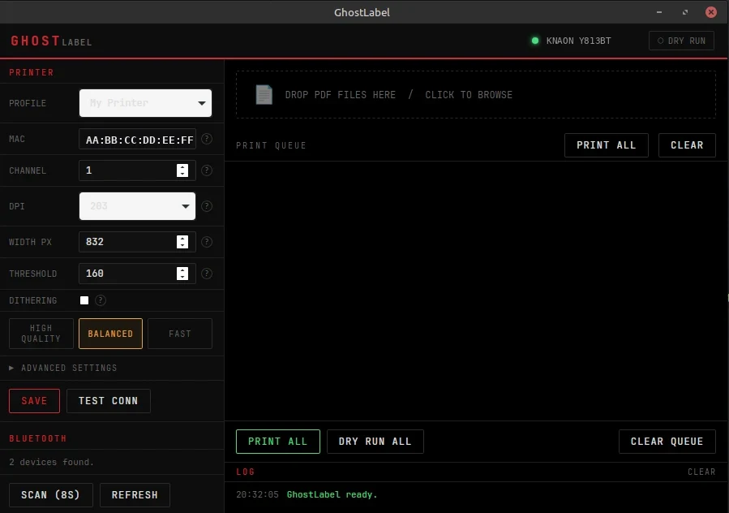

# GhostLabel

GhostLabel prints shipping label PDFs to a KNAON Y813BT Bluetooth thermal label printer from Linux, without the Android app.

---

## What this is

The KNAON Y813BT is a cheap 4-inch Bluetooth thermal label printer sold under several brand names on Amazon and AliExpress. The manufacturer only provides a proprietary Android app called "Flash Label Pro" -- there's no Linux client, SDK, or protocol documentation of any kind. If you want to print from a desktop you have to email the PDF to your phone, open it, share it to the app, and print. Every single time.

I reverse-engineered the printer from scratch so you can drag a PDF onto a window and it prints. That's it.



---

## How I reversed it

### 1. Initial hypothesis: ESC/POS
Most cheap thermal printers in this price range speak ESC/POS over Bluetooth SPP (UUID `00001101-0000-1000-8000-00805F9B34FB`, RFCOMM channel 1). I tried `GS v 0` (raster bit-image, `0x1D 0x76 0x30`) first and it printed -- blurry, but it printed. That confirmed the transport and command set.

### 2. Checking the vendor app
I looked at the vendor's Android app to see whether it used anything beyond standard ESC/POS. Its printing library is aimed at inkjet products, and the Y813BT ignores every command it doesn't understand, so plain ESC/POS is all that's needed.

### 3. Dialing in image quality
Raw ESC/POS at 203 DPI produced readable but poor-quality prints. There were three issues:

| Problem | Root cause | Fix |
|---|---|---|
| Washed-out / light print | No contrast stretching | `autocontrast`: stretch histogram 1st to 99th percentile to 0-255 |
| Horizontal banding (white stripes in solid areas) | Rendering above the printer DPI and downsampling with Lanczos can leave ringing that thresholding turns into evenly spaced white lines on some PDFs | Render Scale is a setting. `1` renders directly at the printer DPI (FAST preset), `2` is the default (BALANCED), `3` is HIGH QUALITY. If you see banding, set it to `1`. |
| Garbled output after failed jobs | Printer still waiting for bytes from previous command | Flush: 64 x `0x00` + `ESC @` before every job |

### 4. ESC/POS commands confirmed working on Y813BT

| Bytes | Command | Purpose |
|---|---|---|
| `1B 40` | ESC @ | Initialize / hard reset |
| `1B 32` | ESC 2 | Set default line spacing |
| `1D 76 30 m xL xH yL yH [data]` | GS v 0 | Raster bit-image (1-bit, MSB = leftmost) |
| `1B 64 04` | ESC d 4 | Feed 4 lines |
| `1D 56 41 03` | GS V A 3 | Partial cut with feed |

One command that doesn't work: `ESC *` (column raster, mode 33). The printer ignores the data bytes and jams waiting for more input. If you accidentally send it, you need to power-cycle the printer or flush with 200+ null bytes followed by `ESC @`.

### 5. Bluetooth connection (raw RFCOMM)

The Rust implementation connects over a raw `libc::socket(31, SOCK_STREAM, 3)` with a manually-constructed `sockaddr_rc`, which means no `rfcomm bind` and no system-level CUPS involvement. BlueZ stores `bdaddr_t` in reversed byte order, so `AA:BB:CC:DD:EE:FF` goes into the struct as `[FF, EE, DD, CC, BB, AA]`.

---

## Install

Download the latest release from the [Releases](../../releases) page.

| Package | Format | Distro |
|---|---|---|
| `GhostLabel_x.x.x_amd64.deb` | Debian package | Ubuntu, Debian, Mint, Pop!_OS |
| `GhostLabel_x.x.x_amd64.AppImage` | Portable executable | Any Linux distro |
| `GhostLabel-x.x.x-1.x86_64.rpm` | RPM package | Fedora, RHEL, openSUSE |

You'll also need `poppler-utils` on your machine -- GhostLabel shells out to `pdftoppm` to render PDFs:

```bash
# Ubuntu / Debian / Mint
sudo apt install poppler-utils

# Fedora
sudo dnf install poppler-utils

# Arch
sudo pacman -S poppler
```

**Debian / Ubuntu:**
```bash
sudo dpkg -i GhostLabel_*.deb
```

**AppImage (any distro):**
```bash
chmod +x GhostLabel_*.AppImage
./GhostLabel_*.AppImage
```

Pair your printer in System Settings -> Bluetooth before first launch.

---

## Build from source

Requires Rust 1.88+, Node.js 18+, and `poppler-utils`.

```bash
npm install
npm run build
```

Packages are written to `src-tauri/target/release/bundle/`.

---

## Verifying release binaries

Each release asset has a matching `.minisig` file made with [minisign](https://jedisct1.github.io/minisign/). The public key is `signing/ghostlabel.pub` in this repo (key ID `2922EEA6A1D06B0B`).

**Public key:**
```
RWQLa9Chpu4iKdunJ/qhaiOisIb+tVYsHDb6xKkjdeHXJePY9oMYGeY0
```

**Verify a downloaded file** (keep its `.minisig` next to it):
```bash
# With the public key file
minisign -Vm GhostLabel_0.1.0_amd64.deb -p signing/ghostlabel.pub

# Or inline
minisign -Vm GhostLabel_0.1.0_amd64.deb -P RWQLa9Chpu4iKdunJ/qhaiOisIb+tVYsHDb6xKkjdeHXJePY9oMYGeY0
```

The private key is not in this repository, so only the author can produce valid signatures.

---

## Usage

1. Launch GhostLabel
2. Drag-and-drop one or more PDF files onto the drop zone (or click to browse)
3. Click **Print All**

First-run: click the gear icon to set your printer's MAC address. Config is saved to `~/.config/ghostlabel/config.json`.

### Settings

**Basic**

| Setting | Default | Notes |
|---|---|---|
| Bluetooth MAC | | Your printer's MAC. Use SCAN to find it. |
| RFCOMM Channel | `1` | Don't change unless connection fails |
| DPI | `203` | Match your printer's thermal head resolution (203 or 300) |
| Width (px) | `832` | Max printable pixels at native DPI. KNAON Y813BT = 832 |
| Threshold | `160` | Darkness cutoff. Higher = more dots printed = darker output |
| Dithering | off | Floyd-Steinberg for photos. Leave off for barcodes/text |

**Quick presets:** one-click starting points, tunable from there:

| Preset | Use case |
|---|---|
| HIGH QUALITY | Sharpest barcodes, slowest transfer. Best for archival or problem labels. |
| BALANCED | Default. Good for most shipping labels. |
| FAST | Minimal processing, quickest print. Fine for bulk jobs. |

**Advanced** (expand in sidebar)

| Setting | Default | Notes |
|---|---|---|
| Render Scale | `2` | PDF rendered at DPI x scale then downsampled. 2 = 2x supersampling |
| Sharpen | `0.7` | Unsharp mask before threshold. 0 = off. >1.2 causes halos |
| Slice Lines | `48` | Lines per BT packet. Lower if printer pauses mid-label |
| Slice Delay | `80ms` | Pause between packets. Increase if thermal head overheats |
| Heat Time | `255` | ESC 7 heating duration. Higher = darker. 0 = skip command |
| Heat Dots | `15` | ESC 7 heating dots. Typically 7-15 for narrow printers |

---

## Printer compatibility

Tested on the **KNAON Y813BT** (4-inch thermal, 203 DPI, Bluetooth SPP). Similar printers are reportedly sold under other brand names (HPRT, Xprinter, Munbyn, Polono and others) with the same hardware, but that is unverified and only the KNAON Y813BT has been tested. If your printer accepts ESC/POS `GS v 0` over Bluetooth RFCOMM, it may work.

---

## License

GPL-3.0
